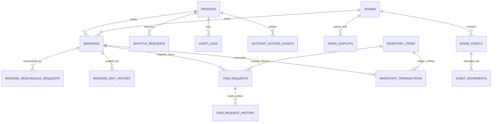

# Victory Church Room Reservation System — Database Schema & Migrations Audit

This document details the PostgreSQL database architecture, migrations log (0001 through 0017), entity relationships, cascade policies, and Row-Level Security (RLS) enforcement model for the Victory Church Room Reservation System.

---

## 1. Security Architecture & RLS Model

The database operates under strict defense-in-depth security principles:

1. **Role Separation**:
   - Application queries run as the restricted PostgreSQL role **`app_member`**, initialized via `asMember(userId)` with session variables:
     - `set role app_member;`
     - `select set_config('app.user_id', $1, false);`
   - Master operations (initial profile bootstrap, admin elevation functions) run with elevated privileges via `SECURITY DEFINER` functions with fixed `search_path = ''`.
2. **Access Control Hierarchy**:
   - `public.app_current_user_id()` extracts the verified UUID from the session context `app.user_id`.
   - `public.is_active_member()` verifies that the caller has an active profile (`access_status = 'active'`). Pending accounts cannot view or create bookings.
   - `public.is_admin()` verifies that the caller has `role = 'admin'` and `access_status = 'active'`.
   - Normal users cannot escalate privileges or approve their own bookings/access.
3. **Defense Against Overbooking & Race Conditions**:
   - PostgreSQL exclusionary constraints using GiST (`btree_gist` extension) and transactional row-level advisory locks prevent double-booking identical room timeframes across concurrent sessions.

---

## 2. Complete Migrations Ledger (0001 – 0017)

| Migration | File | Domain | Summary |
|---|---|---|---|
| **0001** | `0001_core_schema.sql` | Core Platform | Profiles, Rooms, Bookings, Announcements. Enforces 30-min booking intervals, 90-day booking horizons, operating hours, capacity limits, and GiST overlap prevention. |
| **0002** | `0002_security.sql` | RLS & Permissions | Defines `app_member` role, row level security policies for member self-access and admin review powers. |
| **0003** | `0003_seed_rooms.sql` | Seeds | Seeds 5 production rooms mapped to GoHighLevel (GHL) calendar IDs. |
| **0004** | `0004_profiles_email_index.sql` | Performance | Adds unique index on `lower(email)` for fast auth lookup. |
| **0005** | `0005_access_phone_google.sql` | Integrations & Access | Account approval workflow (`pending`, `active`, `denied`, `revoked`), E.164 phone validation, Google Calendar OAuth token store, and daily verse cache. |
| **0006** | `0006_access_events.sql` | Audit Trail | `account_access_events` tracking state transitions for user accounts with admin actor logging. |
| **0007** | `0007_announcement_orientation.sql` | Announcements | Adds `orientation` (`portrait` 4:5 vs `landscape` 16:9) to announcements. |
| **0008** | `0008_bot_api.sql` | WhatsApp Assistant | Adds `source` (`web` vs `whatsapp`), `whatsapp_message_id` deduplication, and notification dispatch logging. |
| **0009** | `0009_reschedule_requests.sql` | Rescheduling | `booking_reschedule_requests` for proposing time shifts without releasing original approved slots until admin confirmation. |
| **0010** | `0010_denial_notifications_roles.sql` | Admin & Notifications | Denial error logging, prevention of past-due request approvals, and admin promotion/demotion functions protecting the last active admin. |
| **0011a** | `0011_admin_booking_edits.sql` | Admin Operations | `booking_edit_history` tracking full pre/post delta whenever an admin reschedules or modifies an existing booking. |
| **0011b** | `0011_kiosk_displays.sql` | Hardware & Kiosks | `kiosk_displays` storing pairing tokens, hardware heartbeat timestamps, and display modes (`door_sign` tablet vs `lobby_hub` TV). |
| **0012a** | `0012_inventory.sql` | Logistics & Inventory | `inventory_items` tracking consumables and loanable gear (stock on hand, min stock thresholds, categories, units). |
| **0012b** | `0012_shuttle.sql` | Logistics & Transport | `shuttle_requests` for church vehicle booking, gas/toll expense reconciliation, and driver assignment. |
| **0013** | `0013_inventory_transactions.sql` | Inventory Ledger | `inventory_transactions` double-entry stock ledger linking consumption to specific rooms, bookings, or ministries. |
| **0014** | `0014_room_assets.sql` | Fixed & Movable Assets | `room_assets` with unique barcode/asset tags, condition tracking, and `asset_movements` relocation history. |
| **0015** | `0015_security_and_audit.sql` | Governance & RBAC | `audit_logs` system-wide audit trail with JSONB diffs, IP logging, and actor roles. |
| **0016** | `0016_item_requests.sql` | Booking Add-ons | `item_requests` and `item_request_history` allowing ministries to request consumables/gear as part of their room reservation. |
| **0017** | `0017_custom_item_requests.sql` | Custom Requests | Relaxes `item_id` foreign key requirement to permit ad-hoc / non-catalog item requests with required description notes. |

---

## 3. Entity-Relationship (ER) Architecture

---

## 4. Foreign Key Constraints & Cascade Policies

| Source Table | Foreign Key Column | Target Table | On Delete Rule | Rationale |
|---|---|---|---|---|
| `bookings` | `user_id` | `profiles(id)` | `RESTRICT` | Preserve historical booking records even if member profile is altered. |
| `bookings` | `room_id` | `rooms(id)` | `RESTRICT` | Prevent accidental deletion of rooms with existing booking history. |
| `booking_reschedule_requests` | `booking_id` | `bookings(id)` | `CASCADE` | If a booking is deleted, pending reschedule requests are removed. |
| `booking_reschedule_requests` | `room_id` | `rooms(id)` | `RESTRICT` | Rooms cannot be deleted while reservations/reschedules exist. |
| `booking_edit_history` | `booking_id` | `bookings(id)` | `CASCADE` | Edit audit records mirror lifetime of parent booking. |
| `kiosk_displays` | `room_id` | `rooms(id)` | `SET NULL` | If a room is removed, physical tablet unlinks gracefully into unassigned pool. |
| `inventory_transactions` | `item_id` | `inventory_items(id)`| `CASCADE` | Transaction history cascades with item lifecycle. |
| `inventory_transactions` | `room_id` | `rooms(id)` | `SET NULL` | Preserves transaction ledger entry if room metadata changes. |
| `inventory_transactions` | `booking_id`| `bookings(id)` | `SET NULL` | Preserves financial/material consumption ledger if booking is removed. |
| `room_assets` | `room_id` | `rooms(id)` | `RESTRICT` | Rooms containing assigned physical equipment cannot be deleted. |
| `asset_movements` | `asset_id` | `room_assets(id)` | `CASCADE` | Asset movement ledger cascades with asset record. |
| `item_requests` | `booking_id` | `bookings(id)` | `CASCADE` | Item requests belong directly to a room reservation. |
| `item_requests` | `item_id` | `inventory_items(id)`| `RESTRICT` (nullable) | Cannot drop inventory item currently tied to pending/approved requests. |
| `item_request_history` | `item_request_id` | `item_requests(id)` | `CASCADE` | Status history cascades if parent request is deleted. |
| `audit_logs` | `actor_id` | `profiles(id)` | `SET NULL` | Retains immutable audit logs even if user accounts are purged. |

---

## 5. Row-Level Security (RLS) Matrix

| Table | `app_member` SELECT | `app_member` INSERT | `app_member` UPDATE | `app_member` DELETE |
|---|---|---|---|---|
| **`rooms`** | Active rooms (Admin: all) | Admin only | Admin only | Admin only |
| **`bookings`** | All active members | Own bookings (`is_active_member()`) | Admin review / User cancel | Admin only |
| **`booking_reschedule_requests`** | Own requests or Admin | Request owner (`status='pending'`) | Admin review / User cancel | Admin only |
| **`kiosk_displays`** | Public displays (`is_active=true`) | Admin only | Admin only | Admin only |
| **`inventory_items`** | All active members | Admin only | Admin only | Admin only |
| **`inventory_transactions`** | Admin only | Admin only | Denied (Immutable Ledger) | Denied |
| **`room_assets`** | All active members | Admin only | Admin only | Admin only |
| **`asset_movements`** | Admin only | Admin only | Denied (Immutable Ledger) | Denied |
| **`item_requests`** | Booking owner or Admin | Booking owner (`is_active_member()`) | Admin review | Admin only |
| **`audit_logs`** | Admin only | Allowed (System write) | Denied (Append Only) | Denied |
| **`shuttle_requests`** | Own requests or Admin | Own requests (`is_active_member()`) | Admin review | Admin only |

---

## 6. Verification Status

All 17 database migrations are validated via unit & integration tests on PGlite with `btree_gist`:
- **Vitest Schema Suite**: `tests/db/database.test.ts` (33/33 tests passing).
- **Playwright E2E**: `e2e/rooms.spec.ts` (100% passing across room lifecycle: creation, dimensions, cooling specs, archiving, and restoration).
