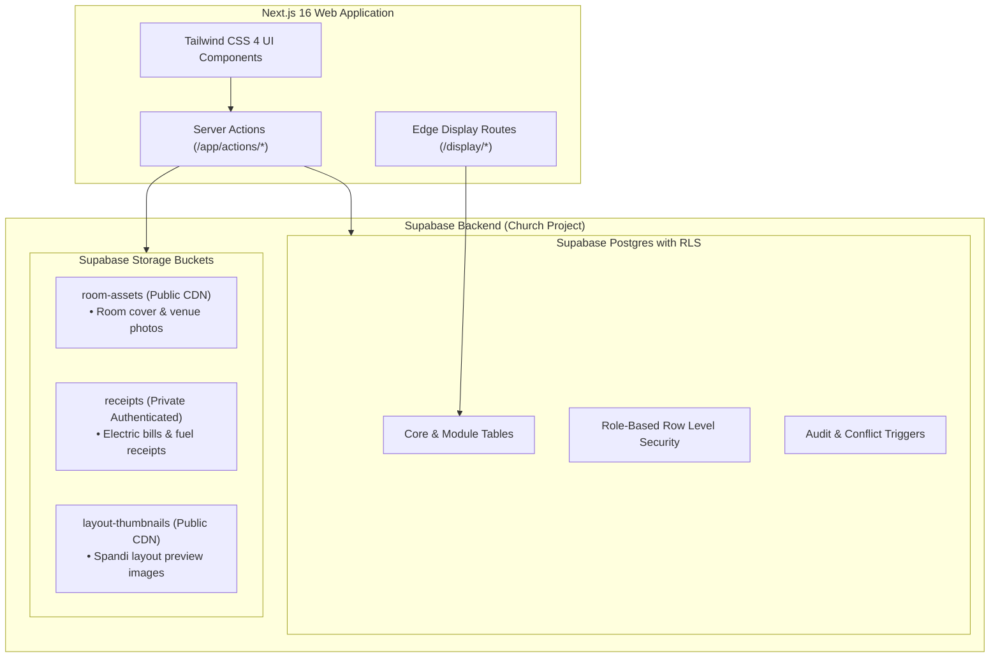
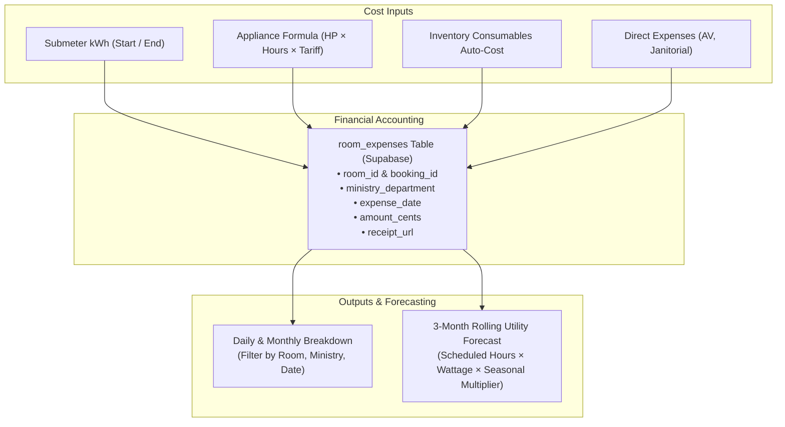
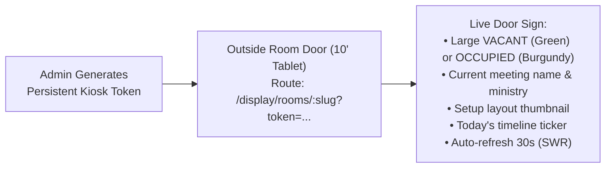
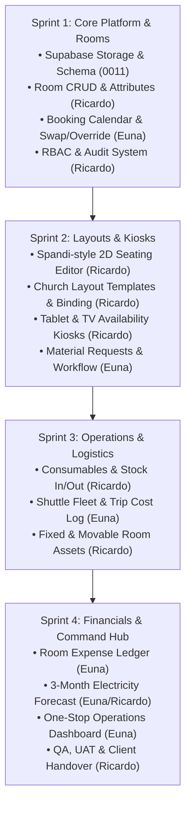

# Victory Rooms — Enterprise Church Operations Master Blueprint & Task Tracker

> **Repository:** `https://github.com/makifornanin/Booking-System-Victory`  
> **System Purpose:** Church facilities reservation, visual seating arrangement, inventory, shuttle fleet, and utility expense forecasting platform for **Victory Church**.  
> **Infrastructure:** **Supabase** (Postgres + Row Level Security + Storage Buckets) with Next.js 16 App Router & TypeScript.  
> **Target Audience:** Engineering Team (**Ricardo**, **Euna**, and contributors).

---

## 1. Master Task Tracker & Engineering Assignment Matrix

This matrix merges the team's official sprint tracker with all architectural and church operational specifications:

| Module | Task | Details & Acceptance Criteria | Assignee | Priority | Target Deliverable / Branch |
|---|---|---|---|---|---|
| **Platform** | Database schema | Tables, relations, enums & RLS policies covering all 24 tasks below in Supabase Postgres | **Ricardo** | High | `feat/supabase-schema-expansion` |
| **Rooms** | Room CRUD | Create, edit, and archive rooms flexibly (name, capacity, location, dimensions, photo upload to Supabase Storage `room-assets`) | **Ricardo** | High | `feat/room-crud-management` |
| **Rooms** | Room attributes | Custom fields & tags per room (AC tonnage, base wattage, equipment tags) without code changes | **Ricardo** | Medium | `feat/room-custom-attributes` |
| **Bookings** | Booking calendar | Multi-view calendar (day/week/month) per room with fast creation, ministry tagging, and conflict detection | **Euna** | High | `feat/booking-calendar-views` |
| **Bookings** | Swap / override | One-click swap between rooms and emergency admin override with automated displaced notification | **Euna** | High | `feat/booking-swap-override` |
| **Bookings** | Flexible adjustments | Self-service reschedule & room transfer with full audit trail history | **Euna** | Medium | `feat/booking-adjustments-history` |
| **Layout** | Chair/table editor | Interactive 2D drag-and-drop floor plan editor (Spandi's-style) with snap-to-grid, pan/zoom, rotate (0-135°) | **Ricardo** | High | `feat/spandis-layout-editor` |
| **Layout** | Layout templates | Save church presets (Sunday Service, Life Group circle, Workshop, Banquet) & attach to booking time range | **Ricardo** | Medium | `feat/layout-templates-presets` |
| **Display** | Tablet / TV kiosk | Auto-refreshing wall-mounted door sign (`/display/rooms/:slug`) and lobby matrix TV (`/display/hub`) with token auth | **Ricardo** | High | `feat/kiosk-wall-displays` |
| **Expenses** | Room expense tracking | Daily and monthly expense ledger per room: consumables, cleaning, AV technician honorarium | **Euna** | High | `feat/room-expense-ledger` |
| **Expenses** | Electricity forecasting | Manual submeter reading (kWh start/end) + appliance wattage estimator + 3-month rolling cost forecast | **Euna** / **Ricardo** | Low / High | `feat/utility-electric-forecast` |
| **Inventory** | Consumables catalog | Item master with categories (Communion, Audio/Batteries, Paper, Hospitality), units, reorder levels | **Ricardo** | High | `feat/inventory-catalog-master` |
| **Inventory** | Stock in / out | Stock-in restocks and Stock-out logs linked to specific room bookings or church events | **Ricardo** | High | `feat/inventory-stock-transactions` |
| **Inventory** | Inventory reports | Stock movement history per room/event, current balances, and low-stock dashboard alerts | **Ricardo** | Medium | `feat/inventory-reports-alerts` |
| **Requests** | Material / item requests | Room setup rider form (e.g. 50 chairs, 2 wireless mics, whiteboard) submitted with booking | **Euna** | High | `feat/material-rider-requests` |
| **Requests** | Request tracking | Workflow state engine: `Submitted` ➔ `Approved` ➔ `Fulfilled/Ready` ➔ `Returned` with history | **Euna** | High | `feat/request-tracking-workflow` |
| **Assets** | Room assets | Asset register per room (fixed: AC, projector, stage fixtures vs movable: mics, music stands, tables) | **Ricardo** | Medium | `feat/room-asset-register` |
| **Assets** | Asset movement | Transfer log when movable assets are loaned or relocated between rooms | **Ricardo** | Low | `feat/asset-movement-history` |
| **Shuttle** | Shuttle trips | Fleet register (vans, plates, drivers) & trip dispatch log (origin, destination, timestamps) | **Euna** | Medium | `feat/shuttle-fleet-dispatch` |
| **Shuttle** | Shuttle costs | Fuel liters pumped, gas cost in PHP, toll fee logs with receipt photo upload | **Euna** | Medium | `feat/shuttle-gas-toll-costs` |
| **Dashboard** | One-stop dashboard | Central command board unifying live rooms, today's setups, fleet on road, low stock, and expense graphs | **Euna** | High | `feat/one-stop-command-hub` |
| **Security** | User matrix (RBAC) | Granular church roles (`super_admin`, `facility_admin`, `usher_lead`, `inventory_officer`, `finance_officer`, `member`) | **Ricardo** | High | `feat/church-rbac-matrix` |
| **Security** | Audit trail | Immutable event log capturing who did what, when, previous vs new JSON values, and IP address | **Ricardo** | High | `feat/audit-trail-system` |
| **Platform** | Deployment & testing | Supabase production handover, QA on tablet/TV/mobile/desktop, Vitest + Playwright UAT | **Ricardo** | Medium | `feat/prod-deployment-uat` |

---

## 2. Supabase Infrastructure & Client Handover Architecture



### 2.1 Zero-Friction Client Project Handover
When deploying to the church's official Supabase project:
1. Create a standard Supabase project (Singapore region `ap-southeast-1` recommended for lowest latency in the Philippines).
2. Run migration `0011_expansion_modules.sql` in the Supabase SQL Editor.
3. Configure environment variables in `.env.local` (or Vercel / Coolify):
   ```env
   NEXT_PUBLIC_SUPABASE_URL=https://<church-project-ref>.supabase.co
   NEXT_PUBLIC_SUPABASE_ANON_KEY=ey...
   SUPABASE_SERVICE_ROLE_KEY=ey...
   DATABASE_URL=postgresql://postgres.<church-project-ref>:<password>@aws-0-ap-southeast-1.pooler.supabase.com:6543/postgres?pgbouncer=true
   ```
4. All storage buckets (`room-assets`, `receipts`, `layout-thumbnails`) are created automatically by the migration script with appropriate RLS policies.

---

## 3. Detailed Specifications for Assigned Modules

### 3.1 Layout & Visual Seating Editor (Ricardo)
*Task: Chair/table arrangement editor & Layout templates*

The visual layout editor follows the Spandis canvas design:


- **Canvas Capabilities:**
  - Center interactive 2D grid with $0.5\text{ m}$ snap-to-grid.
  - Pan background (drag surface), Zoom (mouse wheel / toolbar buttons $50\% - 150\%$).
  - Element rotation: $0^\circ, 45^\circ, 90^\circ, 135^\circ$.
  - Elements:
    - Tables: Round 36", 48", 60", 72", Rectangular 30"×72", 30"×96", Highboy 24".
    - Stage / Podium / Pulpit / Sound & Streaming Booth.
    - Architectural: Walls (H/V), Pillars, Doors, Windows, Center & Side Aisles.
- **Church Templates:**
  - Saved per room: *Sunday Worship (Theater rows + Stage)*, *Life Group Circle*, *Ministry Workshop (Classroom tables)*, *Boardroom Conference*, *Kids Church Activity*.
- **Booking Time-Range Binding:**
  - Requester picks a layout template when reserving a room.
  - Ushers access `/admin/setups` to view the room diagram before the booking starts and mark the room as "Ready".
  - One-click Print / PDF button for clipboard use.

---

### 3.2 Expenses, Utility Accounting & 3-Month Forecasting (Euna & Ricardo)
*Task: Room expense tracking & Electricity consumption*

Provides church administration and finance with clear accounting of where money goes per room, per day, and per month, with predictive utility forecasting.



- **Electricity Tracking:**
  - **Option 1 (Hardware Submeter):** Facility staff enters `meter_reading_start` and `meter_reading_end`. System calculates:
    $$\text{Electricity Cost} = (\text{kWh}_{\text{end}} - \text{kWh}_{\text{start}}) \times \text{Tariff Rate (e.g. ₱12.50)}$$
  - **Option 2 (Formula Estimator):**
    $$\text{Estimated kWh} = \left(\sum (\text{Aircon HP} \times 0.746 \times 0.8) + \frac{\text{Lighting \& AV Watts}}{1000}\right) \times \text{Duration (Hours)}$$
- **3-Month Rolling Forecast Algorithm:**
  - Sums upcoming approved booking hours over the next 90 days.
  - Multiplies by room hourly electrical draw and active utility tariff.
  - Incorporates seasonal church calendar weight:
    - Normal months: $1.0\times$
    - Midyear Prayer & Fasting: $1.15\times$
    - Holy Week / Easter: $1.20\times$
    - Christmas / Year-end services: $1.30\times$
- **Receipts & Invoices:** Digital receipt photos uploaded directly to the private `receipts` bucket in Supabase Storage.

---

### 3.3 Wall Tablet & Lobby TV Digital Signage (Ricardo)
*Task: Tablet / TV availability view*

Hardware-agnostic kiosk displays for wall-mounted tablets outside doors and large Smart TVs in church hallways.



- **How Tablets & TVs Connect:**
  1. Admin opens `/admin/displays` and clicks **"Add Display Screen"**.
  2. Selects display type (*Door Sign for specific room* or *Multi-Room Lobby Hub*).
  3. System generates a persistent URL with a secure pairing token (e.g. `https://rooms.victory.org.ph/display/rooms/hall-a?token=kiosk_7a9f...`).
  4. On the wall tablet (Samsung Galaxy Tab, Lenovo, or iPad):
     - Install **Fully Kiosk Browser** (Android) or enable **Guided Access** (iOS).
     - Enter the display URL. The tablet stays on full-screen kiosk mode with zero session expiration or password prompts.
  5. On the Lobby TV: Open the TV's browser (Android TV, Tizen, webOS) and navigate to `/display/hub?token=...`.
- **Offline Resilience:** If church WiFi drops momentarily, the display smoothly presents cached schedule data from `localStorage` without disruptive alert modals.

---

### 3.4 Booking Calendar, Swapping, Overrides & Riders (Euna)
*Tasks: Booking calendar, Swap / override, Flexible adjustments, Material requests, Request tracking*

- **Calendar Views:** Interactive Day, Week, and Month views per room with color-coded ministry tags (Youth, Worship, Kids, Pastoral, Admin).
- **Admin Swap:** Swap two simultaneous bookings between Room A and Room B with a single confirmation modal if capacities allow.
- **Emergency Priority Override:** Active administrators can preempt existing reservations for urgent pastoral crises, funerals, or church-wide gatherings. Automated notifications (SMS/Email via GHL) are triggered to the displaced party with priority reschedule options.
- **Material Setup Rider:**
  - Requester checks required items during booking (e.g., 50 Monobloc chairs, 4 wireless mics, 2 music stands, 1 communion table, 1 HDMI switcher).
  - Status lifecycle: `Submitted` ➔ `Approved` ➔ `In Progress` ➔ `Ready` ➔ `Returned`.

---

### 3.5 Inventory, Consumables & Room Assets (Ricardo)
*Tasks: Consumables catalog, Stock in / out, Inventory reports, Room assets, Asset movement*

- **Consumables Catalog:** Master catalog grouped by category (*Communion elements*, *Audio/Tech 9V & AA batteries*, *Hospitality/Coffee*, *Paper/Pens/Envelopes*, *Sanitation/Cleaning*).
- **Stock In / Out Ledger:**
  - *Stock In:* Log supplier delivery, batch quantity, and unit cost.
  - *Stock Out:* Allocated directly to a specific Room Booking ID or Ministry Event.
- **Low Stock Alerts:** Dashboard banner when stock dips below configurable safety threshold.
- **Room Assets (Fixed vs Movable):**
  - Fixed: Air conditioning units, ceiling projectors, sound baffles, stage lighting.
  - Movable: Wireless microphones, DI boxes, clickers, folding tables, music stands.
  - Movement history: Audit log when movable gear is transferred between venues.

---

### 3.6 Shuttle Fleet Dispatch & Cost Log (Euna)
*Tasks: Shuttle trips, Shuttle costs*

- **Fleet Register:** Van records (Van 1, Van 2, Van 3, plate number, passenger capacity, status).
- **Trip Dispatch:** Ministry name, driver assigned, origin, destination, scheduled departure, and return times.
- **Trip Cost Tracking:** Fuel liters, gasoline cost in PHP, toll fees, and receipt photo upload to Supabase Storage.

---

### 3.7 One-Stop Operations Command Dashboard (Euna)
*Task: One-stop dashboard*

A single executive operations console for church administrators and facility directors:
- **Live Room Ribbon:** Instant occupancy state across all sanctuary halls and breakout rooms.
- **Today's Setup Checklist:** Material riders and layout diagrams needed for upcoming events today.
- **Logistics & Fleet:** Vehicles currently out on trips and driver status.
- **Inventory Warnings:** Supplies reaching critical reorder levels.
- **Expense Meter:** Month-to-date electricity and consumables expenditure vs monthly budget.

---

### 3.8 Security: User Matrix & Audit Trail (Ricardo)
*Tasks: User matrix, Audit trail*

- **Church RBAC Matrix:**
  - `super_admin`: Full system control, role assignment, financial budgets, emergency overrides.
  - `facility_admin`: Manage rooms, Spandi layouts, approve material riders, log assets.
  - `usher_lead`: View daily setup diagrams, mark rooms as "Ready".
  - `inventory_officer`: Manage consumables, record stock in/out, monitor thresholds.
  - `finance_officer`: Manage electricity tariffs, review room expense ledgers, access 3-month forecast.
  - `ministry_head`: Reserve rooms, customize seating layout, submit material requests.
  - `church_member`: Standard booking requests, view personal schedule.
- **Audit Trail:** Immutable `audit_logs` table recording actor, action (`room.create`, `booking.override`, `layout.update`, `expense.log`), previous vs new JSON state, IP address, and timestamp.

---

## 4. Complete Database Schema (Supabase Postgres DDL)

Save and run in Supabase SQL Editor (`db/migrations/0011_expansion_modules.sql`):

```sql
-- ============================================================================
-- 1. SUPABASE STORAGE BUCKETS
-- ============================================================================
INSERT INTO storage.buckets (id, name, public)
VALUES 
  ('room-assets', 'room-assets', true),
  ('receipts', 'receipts', false),
  ('layout-thumbnails', 'layout-thumbnails', true)
ON CONFLICT (id) DO NOTHING;

CREATE POLICY "Public Read Room Assets" ON storage.objects
  FOR SELECT USING (bucket_id IN ('room-assets', 'layout-thumbnails'));

CREATE POLICY "Staff Upload Assets" ON storage.objects
  FOR INSERT TO authenticated
  WITH CHECK (bucket_id IN ('room-assets', 'layout-thumbnails', 'receipts'));

CREATE POLICY "Finance Read Receipts" ON storage.objects
  FOR SELECT TO authenticated
  USING (bucket_id = 'receipts');

-- ============================================================================
-- 2. ROOMS & ATTRIBUTES
-- ============================================================================
ALTER TABLE public.rooms 
  ADD COLUMN IF NOT EXISTS campus text NOT NULL DEFAULT 'Main Campus',
  ADD COLUMN IF NOT EXISTS building text NOT NULL DEFAULT 'Main Building',
  ADD COLUMN IF NOT EXISTS floor_level text NOT NULL DEFAULT 'Ground Floor',
  ADD COLUMN IF NOT EXISTS dimensions_l_m numeric(5,2) DEFAULT 10.00,
  ADD COLUMN IF NOT EXISTS dimensions_w_m numeric(5,2) DEFAULT 8.00,
  ADD COLUMN IF NOT EXISTS aircon_hp_total numeric(4,1) DEFAULT 5.0,
  ADD COLUMN IF NOT EXISTS base_wattage_lights_av integer DEFAULT 1200,
  ADD COLUMN IF NOT EXISTS room_attributes jsonb DEFAULT '{}',
  ADD COLUMN IF NOT EXISTS is_archived boolean NOT NULL DEFAULT false;

-- ============================================================================
-- 3. SPANDI-STYLE SEATING LAYOUT TEMPLATES
-- ============================================================================
CREATE TABLE IF NOT EXISTS public.room_layout_templates (
  id uuid PRIMARY KEY DEFAULT gen_random_uuid(),
  room_id uuid NOT NULL REFERENCES public.rooms(id) ON DELETE CASCADE,
  name text NOT NULL,
  description text,
  canvas_data jsonb NOT NULL,
  total_tables integer NOT NULL DEFAULT 0,
  total_seats integer NOT NULL DEFAULT 0,
  is_default boolean NOT NULL DEFAULT false,
  thumbnail_url text,
  created_by uuid REFERENCES auth.users(id),
  created_at timestamptz NOT NULL DEFAULT now(),
  updated_at timestamptz NOT NULL DEFAULT now()
);

ALTER TABLE public.bookings 
  ADD COLUMN IF NOT EXISTS layout_template_id uuid REFERENCES public.room_layout_templates(id),
  ADD COLUMN IF NOT EXISTS custom_layout_data jsonb,
  ADD COLUMN IF NOT EXISTS layout_setup_status text NOT NULL DEFAULT 'pending' 
    CHECK (layout_setup_status IN ('pending', 'in_progress', 'ready', 'not_required'));

-- ============================================================================
-- 4. MATERIAL & RIDER REQUESTS
-- ============================================================================
CREATE TABLE IF NOT EXISTS public.booking_material_requests (
  id uuid PRIMARY KEY DEFAULT gen_random_uuid(),
  booking_id uuid NOT NULL REFERENCES public.bookings(id) ON DELETE CASCADE,
  item_name text NOT NULL,
  requested_quantity integer NOT NULL DEFAULT 1,
  status text NOT NULL DEFAULT 'submitted' CHECK (status IN ('submitted', 'approved', 'fulfilled', 'rejected', 'returned')),
  notes text,
  handled_by uuid REFERENCES auth.users(id),
  created_at timestamptz NOT NULL DEFAULT now(),
  updated_at timestamptz NOT NULL DEFAULT now()
);

-- ============================================================================
-- 5. ROOM EXPENSES & ELECTRICITY FORECASTING
-- ============================================================================
CREATE TABLE IF NOT EXISTS public.room_expenses (
  id uuid PRIMARY KEY DEFAULT gen_random_uuid(),
  booking_id uuid REFERENCES public.bookings(id) ON DELETE SET NULL,
  room_id uuid NOT NULL REFERENCES public.rooms(id) ON DELETE CASCADE,
  ministry_department text NOT NULL,
  expense_date date NOT NULL,
  expense_type text NOT NULL CHECK (expense_type IN ('electricity', 'consumables', 'cleaning', 'av_honorarium', 'other')),
  amount_cents bigint NOT NULL,
  kwh_used numeric(8,2),
  meter_reading_start numeric(10,2),
  meter_reading_end numeric(10,2),
  receipt_url text,
  notes text,
  logged_by uuid REFERENCES auth.users(id),
  created_at timestamptz NOT NULL DEFAULT now()
);

CREATE TABLE IF NOT EXISTS public.utility_rates (
  id uuid PRIMARY KEY DEFAULT gen_random_uuid(),
  effective_date date NOT NULL UNIQUE,
  electricity_php_per_kwh numeric(6,2) NOT NULL DEFAULT 12.50,
  set_by uuid REFERENCES auth.users(id),
  created_at timestamptz NOT NULL DEFAULT now()
);

-- ============================================================================
-- 6. INVENTORY & CONSUMABLES
-- ============================================================================
CREATE TABLE IF NOT EXISTS public.inventory_categories (
  id uuid PRIMARY KEY DEFAULT gen_random_uuid(),
  name text NOT NULL UNIQUE,
  slug text NOT NULL UNIQUE,
  description text
);

CREATE TABLE IF NOT EXISTS public.inventory_items (
  id uuid PRIMARY KEY DEFAULT gen_random_uuid(),
  category_id uuid NOT NULL REFERENCES public.inventory_categories(id) ON DELETE RESTRICT,
  name text NOT NULL,
  sku text UNIQUE,
  unit text NOT NULL DEFAULT 'pcs',
  quantity_on_hand integer NOT NULL DEFAULT 0,
  reorder_level integer NOT NULL DEFAULT 10,
  unit_cost_cents bigint DEFAULT 0,
  created_at timestamptz NOT NULL DEFAULT now(),
  updated_at timestamptz NOT NULL DEFAULT now()
);

CREATE TABLE IF NOT EXISTS public.inventory_transactions (
  id uuid PRIMARY KEY DEFAULT gen_random_uuid(),
  item_id uuid NOT NULL REFERENCES public.inventory_items(id) ON DELETE CASCADE,
  transaction_type text NOT NULL CHECK (transaction_type IN ('in', 'out', 'adjustment')),
  quantity integer NOT NULL,
  booking_id uuid REFERENCES public.bookings(id) ON DELETE SET NULL,
  room_id uuid REFERENCES public.rooms(id) ON DELETE SET NULL,
  notes text,
  cost_cents bigint DEFAULT 0,
  logged_by uuid REFERENCES auth.users(id),
  created_at timestamptz NOT NULL DEFAULT now()
);

-- ============================================================================
-- 7. ROOM ASSETS & MOVEMENT LOG
-- ============================================================================
CREATE TABLE IF NOT EXISTS public.room_assets (
  id uuid PRIMARY KEY DEFAULT gen_random_uuid(),
  room_id uuid NOT NULL REFERENCES public.rooms(id) ON DELETE CASCADE,
  name text NOT NULL,
  asset_tag text UNIQUE,
  asset_type text NOT NULL CHECK (asset_type IN ('fixed', 'movable')),
  condition text NOT NULL DEFAULT 'good' CHECK (condition IN ('excellent', 'good', 'needs_repair', 'decommissioned')),
  serial_number text,
  notes text,
  created_at timestamptz NOT NULL DEFAULT now(),
  updated_at timestamptz NOT NULL DEFAULT now()
);

CREATE TABLE IF NOT EXISTS public.asset_movements (
  id uuid PRIMARY KEY DEFAULT gen_random_uuid(),
  asset_id uuid NOT NULL REFERENCES public.room_assets(id) ON DELETE CASCADE,
  from_room_id uuid NOT NULL REFERENCES public.rooms(id),
  to_room_id uuid NOT NULL REFERENCES public.rooms(id),
  reason text,
  moved_by uuid REFERENCES auth.users(id),
  moved_at timestamptz NOT NULL DEFAULT now()
);

-- ============================================================================
-- 8. SHUTTLE FLEET & TRIPS
-- ============================================================================
CREATE TABLE IF NOT EXISTS public.shuttles (
  id uuid PRIMARY KEY DEFAULT gen_random_uuid(),
  name text NOT NULL,
  plate_number text NOT NULL UNIQUE,
  capacity integer NOT NULL DEFAULT 12,
  is_active boolean NOT NULL DEFAULT true
);

CREATE TABLE IF NOT EXISTS public.shuttle_drivers (
  id uuid PRIMARY KEY DEFAULT gen_random_uuid(),
  name text NOT NULL,
  phone text NOT NULL,
  license_number text,
  is_active boolean NOT NULL DEFAULT true
);

CREATE TABLE IF NOT EXISTS public.shuttle_trips (
  id uuid PRIMARY KEY DEFAULT gen_random_uuid(),
  shuttle_id uuid NOT NULL REFERENCES public.shuttles(id),
  driver_id uuid NOT NULL REFERENCES public.shuttle_drivers(id),
  ministry_department text NOT NULL,
  origin text NOT NULL,
  destination text NOT NULL,
  departure_time timestamptz NOT NULL,
  arrival_time timestamptz,
  status text NOT NULL DEFAULT 'scheduled' CHECK (status IN ('scheduled', 'in_transit', 'completed', 'cancelled')),
  gas_cost_cents bigint DEFAULT 0,
  toll_cost_cents bigint DEFAULT 0,
  fuel_liters numeric(6,2),
  odometer_start integer,
  odometer_end integer,
  receipt_url text,
  notes text,
  created_at timestamptz NOT NULL DEFAULT now()
);

-- ============================================================================
-- 9. KIOSK DISPLAYS & SECURITY MATRIX
-- ============================================================================
CREATE TABLE IF NOT EXISTS public.kiosk_displays (
  id uuid PRIMARY KEY DEFAULT gen_random_uuid(),
  token text NOT NULL UNIQUE,
  display_type text NOT NULL CHECK (display_type IN ('door_sign', 'lobby_hub')),
  room_id uuid REFERENCES public.rooms(id) ON DELETE CASCADE,
  label text NOT NULL,
  is_active boolean NOT NULL DEFAULT true,
  last_ping_at timestamptz,
  created_at timestamptz NOT NULL DEFAULT now()
);

CREATE TABLE IF NOT EXISTS public.church_user_roles (
  user_id uuid NOT NULL REFERENCES auth.users(id) ON DELETE CASCADE,
  role text NOT NULL CHECK (role IN (
    'super_admin', 'facility_admin', 'usher_lead', 
    'inventory_officer', 'finance_officer', 'ministry_head', 'church_member'
  )),
  department text,
  assigned_by uuid REFERENCES auth.users(id),
  assigned_at timestamptz NOT NULL DEFAULT now(),
  PRIMARY KEY (user_id, role)
);

CREATE TABLE IF NOT EXISTS public.audit_logs (
  id uuid PRIMARY KEY DEFAULT gen_random_uuid(),
  actor_id uuid REFERENCES auth.users(id),
  actor_name text NOT NULL,
  action text NOT NULL,
  entity_type text NOT NULL,
  entity_id text NOT NULL,
  diff jsonb,
  ip_address text,
  user_agent text,
  created_at timestamptz NOT NULL DEFAULT now()
);
```

---

## 5. Development Sprints & Execution Milestones



### Sprint 1: Core Platform, Rooms & Bookings
- **Ricardo:**
  - Create Supabase migration script `0011_expansion_modules.sql` and verify Storage buckets (`room-assets`, `receipts`, `layout-thumbnails`).
  - Implement `/admin/rooms` with flexible Room CRUD, photo upload, and custom attributes.
  - Set up `church_user_roles` matrix and immutable `audit_logs` service.
- **Euna:**
  - Enhance booking calendar views (Day / Week / Month).
  - Implement booking room swap and emergency admin override with displaced notifications.
  - Implement reschedule history and flexible time adjustments.

### Sprint 2: Spandi Layouts, Kiosks & Material Requests
- **Ricardo:**
  - Build the interactive Spandi-style visual canvas in `src/components/layout-designer/`.
  - Add church layout presets (Sunday Service, Life Group, Workshop, Banquet).
  - Implement `/display/rooms/[slug]` (Door Tablet) and `/display/hub` (Lobby TV) with pairing token auth.
- **Euna:**
  - Build the room material request rider form linked to reservations.
  - Build `/admin/requests` workflow tracker (`Submitted` ➔ `Approved` ➔ `Fulfilled` ➔ `Returned`).

### Sprint 3: Inventory, Assets & Shuttle Fleet
- **Ricardo:**
  - Build consumables catalog with category filtering and reorder threshold badges.
  - Implement Stock-In and Stock-Out logging tied to booking IDs.
  - Build room asset register (fixed vs movable) and asset movement transfer logger.
- **Euna:**
  - Build shuttle fleet register (vans, drivers) and trip dispatch logger.
  - Implement fuel and toll cost logger with receipt photo upload.

### Sprint 4: Expense Forecasting & One-Stop Command Center
- **Euna & Ricardo:**
  - Implement daily and monthly room expense ledger.
  - Implement electricity submeter diffs and appliance HP formula estimator.
  - Build the 3-Month rolling utility expense forecasting algorithm.
  - Build the unified `/admin` One-Stop Operations Command Center.
  - Run end-to-end UAT on desktop, wall tablet, and TV viewports.
